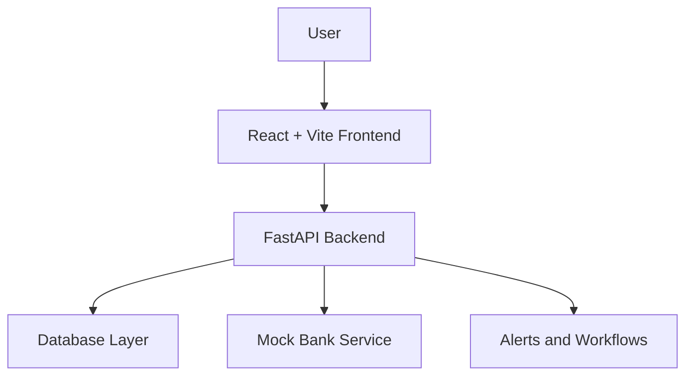

# VINIYOJAN | SIH 2026

### Smart Fixed Deposit Receipt (FDR) Management & Verification

**A FinTech prototype by Team VINIYOJAN for Smart India Hackathon 2026.**

<p align="center">
  <a href="https://github.com/viniyogan/VINIYOJAN-SIH-2026/blob/main/VINIYOJAN_SIH_2026_Demo.mp4">
    
  </a>
</p>

---

## About the Project

VINIYOJAN explores how digital workflows can make Fixed Deposit Receipt (FDR) management more organized, transparent, and efficient.

The prototype combines a web interface, backend services, and a simulated banking service to demonstrate FDR-related record management, document review, verification workflows, and maturity monitoring.

## Features

- 🏦 **FDR Management** — Organize and review fixed deposit records.
- 📄 **Document Review** — Support document submission and verification workflows.
- ⏰ **Maturity Monitoring** — Track maturity-related information and alerts.
- 🔎 **Verification Workflow** — Demonstrate verification using a simulated bank service.
- 📊 **Audit Visibility** — Improve visibility into application activities.

*Feature availability depends on the current prototype implementation.*

## Technology Stack

<p align="left">
  
  
  
  
  
  
  
  
</p>

## System Architecture



The frontend communicates with the backend API. The backend manages application logic and configured data operations, while the mock-bank service simulates banking interactions for demonstration purposes.

## Repository Structure

```text
VINIYOJAN-SIH-2026/
├── VINIYOJAN_SIH_2026_Demo.mp4
└── VINIYOJAN/
    ├── backend/
    │   ├── app/                 # API and application logic
    │   ├── tests/               # Backend tests
    │   ├── Dockerfile
    │   └── requirements.txt
    ├── frontend/
    │   ├── src/                 # UI source and styles
    │   ├── index.html
    │   ├── package.json
    │   └── Dockerfile
    ├── mock-bank/               # Simulated bank service
    ├── docs/                    # Architecture and demo guides
    ├── scripts/                 # Demo utilities
    ├── docker-compose.yml       # Service orchestration
    ├── .env.example             # Environment template
    ├── .gitignore
    ├── README.md                # Detailed project documentation
    
```

## Getting Started

### Prerequisites

- Git
- Node.js and npm
- Python and pip
- Docker Desktop with Docker Compose (for containerized setup)

### 1. Clone the Repository

```bash
git clone https://github.com/viniyogan/VINIYOJAN-SIH-2026.git
cd VINIYOJAN-SIH-2026/VINIYOJAN
```

### 2. Configure Environment Variables

Review `.env.example` and follow the project's configuration instructions. Create the required local environment file with appropriate values.

**Never commit real credentials, API keys, passwords, or private financial data.**

### 3. Start with Docker

Run from the `VINIYOJAN/` directory:

```bash
docker compose up --build
```

Review `docker-compose.yml` for service ports and configuration.

To stop the services:

```bash
docker compose down
```

### Run the Frontend Separately

```bash
cd frontend
npm install
npm run dev
```

Open the local URL printed by Vite. For backend setup, install `backend/requirements.txt` and follow the backend's configuration and startup instructions.

## Project Documentation

| Resource | Description |
|---|---|
| [Architecture](VINIYOJAN/docs/architecture.md) | System design and components |
| [Demo Script](VINIYOJAN/docs/demo-script.md) | Project demonstration guide |
| [Implementation Status](VINIYOJAN/docs/IMPLEMENTATION_STATUS.md) | Current implementation details |
| [Submission Checklist](VINIYOJAN/SUBMISSION_CHECKLIST.md) | Submission preparation |
| [Detailed README](VINIYOJAN/README.md) | Application-level documentation |

## 🎥 Video Demonstration

**VINIYOJAN — SIH 2026 Project Demo**

[▶ View the demo video on GitHub](https://github.com/viniyogan/VINIYOJAN-SIH-2026/blob/main/VINIYOJAN_SIH_2026_Demo.mp4)

GitHub may not preview the MP4 inline. If playback is unavailable, open the video file page and use its download option.

## Team

**Team VINIYOJAN**  
Smart India Hackathon 2026

## Disclaimer

VINIYOJAN is a student-built demonstration prototype. The mock-bank service simulates banking interactions and does not represent an official bank integration or authoritative financial verification. The project is not presented as a production-ready financial system.

---

<p align="center">
  <sub>Built with curiosity, collaboration, and practical FinTech problem-solving.</sub>
</p>
