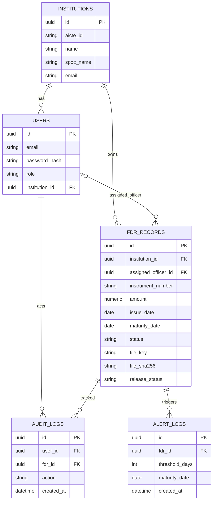
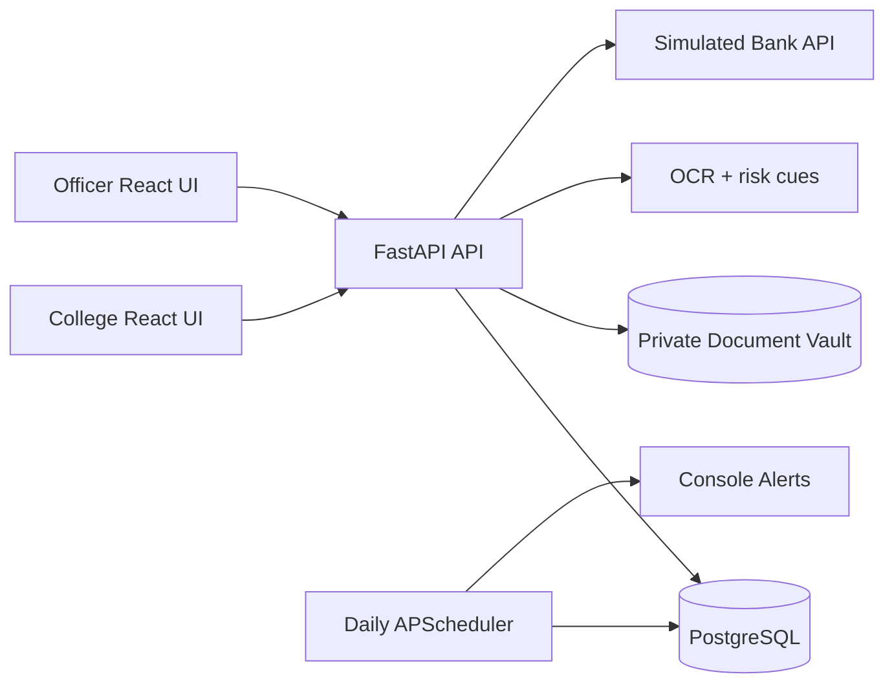

# Design notes and ERD

## Service relationships

## Design differentiators

**Explainable verification queue:** capture and display discrete reasons for manual review instead of a fictitious AI authenticity percentage.

**Deposit clock:** track maturity independently of administrative workflow state to stop alerts being suppressed by a stale status.

**Evidence fingerprints:** private storage with random keys, SHA-256 checksums, and audit events on decisions.

**Release-aware workflow:** separate college intent from officer decision; expand to legally required multi-party sign-off before actual release.

